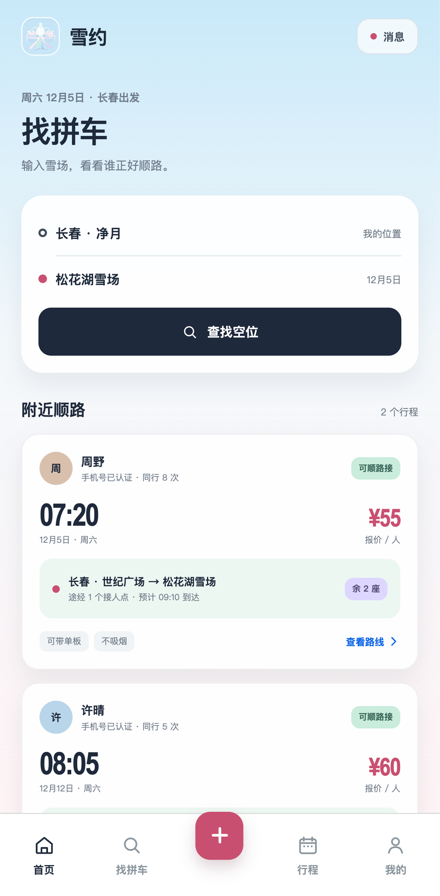

# 雪约 Snowdate

> 滑雪顺路拼车，路线、座位、报价一次说清。

雪约是一款面向滑雪人群的顺路拼车与同行协调 App。车主发布空位、出发时间、雪场、最低报价和可绕行范围；乘客按人数与雪具位提交上车点和报价；车主查看真实路线影响后同意、拒绝或回价。

## 当前状态

可运行 MVP 已完成以下闭环：

- 找拼车：按出发地、雪场和日期筛选结果
- 首次启动：隐私确认、昵称与手机号资料设置
- 地点输入：支持关键词推荐、自定义地点和本机历史地点
- 行程详情：真实道路样例、起终点、已确认接人点、时间和里程
- 申请报价：人数、雪具、上车位置、单人报价和总价
- 车主审核：当前与加入后路线、绕行时间、报价、同意/拒绝/回价
- 回价处理：乘客接受或放弃
- 发布拼车：路线、时间、余座、雪具位、最低价和绕行范围
- 我的行程：我加入的、我发起的、申请状态与待办
- 消息中心：申请、回价、同意拒绝、撤回与满员通知，支持未读和跳转
- 账号与车辆：本机昵称、手机号、车型、颜色和车牌资料
- 服务端基础：Node HTTP API、SQLite、验证码会话和服务端原子锁座
- 本地持久化：刷新或重新打开 App 后恢复
- Android 图标、启动页和 EAS 构建配置



## 开始开发

环境要求：Node.js 22 LTS、npm 10+。

```bash
nvm use
npm ci
npm start
```

常用命令：

```bash
npm run web          # 浏览器预览
npm run android      # Android 模拟器或设备
npm run server       # 启动本地 API http://127.0.0.1:3100
npm run server:test  # API 自动化测试
npm run lint
npm run typecheck
npm run doctor
npm run assets       # 生成应用与商店图片
```

服务端与 Web 预览通常需要两个终端。配置
`EXPO_PUBLIC_API_URL=http://localhost:3100` 后，首次启动会连接服务端验证码；
留空则继续使用纯本机演示模式。详见 [服务端说明](server/README.md)。

## Android 发布

```bash
npx eas-cli@latest login
npx eas-cli@latest init
npm run build:preview   # 测试 APK
npm run build:release   # Google Play AAB
```

发布包名已冻结为 `com.xueyue.snowdate`，开发者主体为蒲乐。详见 [Android 发布手册](docs/ANDROID_RELEASE.md)。

地点搜索默认使用本地推荐与开放地图地点联想。配置
`EXPO_PUBLIC_AMAP_WEB_SERVICE_KEY` 后会优先调用高德地点搜索；正式发布前应使用受限的高德 Key。

## 当前边界

- 本机 UI 仍以 AsyncStorage 数据为准；服务端 API 已完成，但行程与申请的客户端云端同步尚未切换。
- 行程详情使用真实道路样例完成设计验证；正式上线必须接入高德地图 Android SDK，并配置 Key、包名和签名 SHA1。
- 系统分享已经接入；远程推送尚未接入。
- 价格是双方线下协商记录，App 不收款、不托管资金，也不提供承运担保。
- 当前没有公开社交、私信和实时定位。

## 项目结构

```text
src/
  app/
    (tabs)/            首页、找拼车、发布、行程、我的
    ride/[id].tsx      拼车详情
    apply/[id].tsx     申请与报价
    owner/[id].tsx     车主审核
    notifications.tsx  行程消息中心
    onboarding.tsx     首次启动与资料设置
    account.tsx        账号与车辆资料
  components/          导航、地图、卡片和表单组件
  data/                MVP 种子数据
  store/               本地状态与持久化
  lib/                 触觉反馈、确认弹窗
  services/            API 与地点搜索适配
  theme.ts             品牌与组件 Token
server/                Node API、SQLite 与自动化测试
assets/
  logo.png             已选定 Logo
  map/                 真实路线设计样例
design/
  PRODUCT_MINDMAP.md   已确认的产品结构
  UI_HIGH_FIDELITY.md  高保真实现规范
  screens/             设计审阅图
docs/                  产品、发布与合规资料
```

## 文档

- [产品定义](docs/PRODUCT.md)
- [品牌与设计系统](docs/BRAND.md)
- [Android 商店发布](docs/ANDROID_RELEASE.md)
- [当前发布阻塞项](docs/RELEASE_BLOCKERS.md)
- [商店文案](docs/STORE_LISTING.md)
- [MVP 实现状态](docs/IMPLEMENTATION_STATUS.md)
- [服务端 API](server/README.md)
- [隐私政策](PRIVACY.md)
- [完整开发流程](docs/DEVELOPMENT_PLAYBOOK.md)
