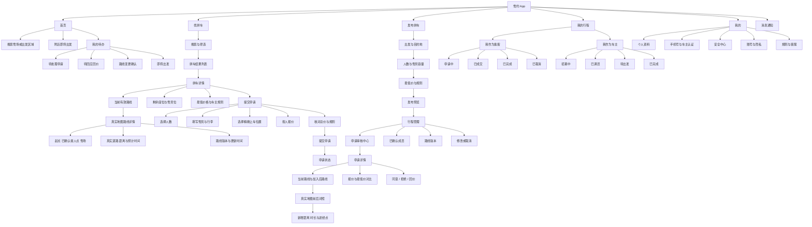

# 雪约 V1 信息架构与用户旅程

版本：V1  
确认日期：2026-11-23

## 主导航

- **首页**：搜索入口、附近行程、我的待办。
- **找拼车**：搜索、筛选、行程详情、申请与报价。
- **发布**：三步发布拼车，使用中间强调入口。
- **行程**：我作为车主、我作为乘客的所有行程。
- **我的**：资料、认证、安全中心、账号与隐私。
- **消息通知**：页头全局入口，通知申请、回价、路线和席位变化。

## 页面信息架构

## 申请状态

| 状态 | 是否占座 | 路线变化 | 下一步 |
| --- | --- | --- | --- |
| 待车主审核 | 否 | 否 | 车主同意、拒绝或回价 |
| 车主回价中 | 否 | 否 | 乘客接受、再想想或放弃 |
| 再想想 | 否 | 否 | 有效期内答复，超时失效 |
| 席位冲突 | 否 | 否 | 重新选车或减少人数 |
| 已成交 | 是 | 生成新版本 | 等待出发 |
| 已拒绝 | 否 | 否 | 寻找其他行程 |
| 已放弃或超时 | 否 | 否 | 可重新申请 |
| 已取消 | 释放 | 更新版本 | 查看记录 |

## 核心规则

- 成交动作必须原子校验余位、锁定价格并生成路线版本。
- 多人申请整组成交，不支持只接受其中一部分乘客。
- 首发版本仅允许一轮回价。
- 未成交展示脱敏位置，成交后才向同行成员公开精确集合点。
- 页面统一使用“费用协商”“已确认价格”“线下结算”，不表现平台支付或担保。
- 拼车详情以真实地图为主要视图，路线由地图服务计算，不使用装饰性示意图替代产品页面。
- 未成交状态仅向申请人与车主展示计算所需的精确位置；公开详情隐藏精确地址。
- 车主审核申请时，地图必须同时展示当前路线与加入申请后的路线差异。
