# 雪约产品思维导图

版本：V1.1  
确认日期：2026-11-23  
阶段：产品设计已确认，等待 UI 方向确认

## 已锁定的核心规则

- 产品定位为滑雪人群的顺路拼车与同行协调工具，不做商业网约车平台。
- 车主发布出发地、时间、雪场、可载人数、雪具容量、最低价和路线条件。
- 乘客选择人数、雪具、上车点和按人报价，多人申请整组成交。
- 车主可查看人数、报价、当前路线和加入后路线，选择同意、拒绝或一轮回价。
- 乘客可接受回价、再想想或放弃；未成交前不占座。
- 成交时原子校验余位，锁定座位和最终价格，生成新路线版本并通知成员。
- 价格按人计算，平台不支付、不托管资金，线下结算。
- 已同行成员始终查看最新路线；新申请者只能查看当前有效路线。
- 首发不做公开社交、私信、支付、实时定位和候补队列。

## 思维导图

```mermaid
mindmap
  root((雪约 · 滑雪拼车))
    产品定位
      滑雪人群的顺路拼车工具
      解决雪场偏远和往返困难
      盘活车主空余座位
      降低乘客到达雪场的成本
      价格属于费用协商
      平台不提供在线支付
      不定位为网约车平台

    用户角色
      车主
        发布出发地
        发布出发时间
        发布目标雪场
        设置可载人数
        设置雪具容量
        设置最低价格
        查看乘客人数和报价
        查看新增途经点与绕行
        同意申请
        拒绝申请
        提出回价
        管理最终路线
      乘客
        搜索雪场与出发区域
        查看当前有效路线
        查看剩余席位
        选择乘车人数
        填写雪具数量
        提交上车位置
        提交价格报价
        接受车主回价
        选择再想想
        放弃申请
      平台
        校验人数与载物容量
        计算总报价
        计算绕行成本
        发送双向通知
        锁定席位
        重算并同步路线
        处理过期和冲突

    发布行程
      基础信息
        出发日期
        出发时间
        目标雪场
        雪场入口或停车场
      出发地点
        精确地址
        集合说明
      车辆条件
        可载乘客数
        雪板或单板容纳数
        行李限制
      费用条件
        最低价格
        单位元每人
        允许设置0元免费顺路
        费用说明
        线下结算提示
      路线条件
        最大绕行时间
        默认15分钟
        可选10分钟
        可选15分钟
        可选30分钟
        可选不限制
      同行条件
        是否允许吸烟
        是否允许宠物
        是否允许儿童
        雪具尺寸限制
      返程安排
        返程时间
        返程集合点

    发现与查看
      搜索条件
        雪场
        日期
        时间段
        出发区域
        剩余座位
        可接雪具
      行程卡片
        出发区域
        目标雪场
        出发时间
        最低价格
        剩余座位
        已确认人数
        当前途经点数量
        招募状态
      行程详情
        当前有效路线
        真实地图底图
        真实道路与驾驶路线
        起终点与编号途经点
        预计距离与到达时间
        脱敏后的途经区域
        车主规则
        当前同行成员
        剩余载人容量
        剩余雪具容量
        最低价格
        预计到达时间
      隐私规则
        未申请时隐藏精确地址
        申请后仅车主可见
        同意后向同行成员公开
        行程完成限制查看

    申请条件
      乘车人数
        最少1人
        最多不超过剩余座位
        多人作为一整组申请
        首发版本整组同意或整组拒绝
      雪具条件
        雪板数量
        单板数量
        普通行李数量
        不超过剩余载物容量
      时间条件
        可接受出发时间
        可接受到达时间
        时间备注
      位置条件
        精确上车位置
        只对车主展示
        系统计算预计绕行
      价格条件
        乘客填写每人的报价
        系统自动计算总报价
        总报价等于单人报价乘人数
      其他信息
        简短备注
        手机号认证状态
        历史同行记录

    报价规则
      价格定义
        统一按人报价
        金额单位为人民币元每人
        平台不扣款
        平台不收手续费
        平台不托管资金
        线下按双方确认金额处理
      发布者最低价
        创建行程时填写
        行程公开页可见
        表示可接受的最低单人价格
        允许0元表示免费顺路
      乘客报价
        申请时填写单人报价
        显示人数
        显示总报价
        报价与拼车申请同时提交
      报价达标
        单人报价达到最低价格
        人数和雪具满足条件
        路线满足最大绕行条件
        车主可一键同意
        车主仍需查看路线
      报价不足
        车主查看新增路线和绕行
        车主可拒绝
        车主可按人回价
        回价后系统计算新总价
        首发版本只允许一轮回价
      乘客回应回价
        接受回价
        系统锁定席位
        进入路线更新流程
        选择再想想
        申请暂不成交
        不锁定席位
        建议30分钟后失效
        放弃申请
        申请关闭
        路线不变
      席位竞争
        待审核时不占座
        回价中时不占座
        接受报价时原子校验余位
        余位不足则申请失效
        成交后立即扣减席位
        其余竞争申请收到满员通知

    车主审核卡
      申请者信息
        昵称
        头像
        认证状态
        历史同行
      本次需求
        乘车人数
        雪具数量
        精确上车点
        期望时间
      价格信息
        最低价格
        乘客单人报价
        乘客总报价
      路线影响
        当前路线
        加入后的路线
        新增途经点
        增加公里数
        增加分钟数
        预计到达时间
      审核动作
        同意当前报价
        拒绝申请
        查看路线后回价
        回价金额按人填写
        回价备注
      拒绝原因
        绕行过多
        报价不合适
        人数或雪具放不下
        时间不匹配

    人数与席位
      总座位
        车主设置的乘客容量
        默认可为1至4人
      已占座位
        所有已同意乘客的人数之和
      剩余座位
        总座位减已占座位
      雪具容量
        按雪板或单板数量计算
        与乘客人身座位分开
      人数校验
        申请人数不能超过剩余座位
        申请雪具不能超过剩余载物量
        成交时再次校验
      满员规则
        剩余座位为0
        行程显示已满员
        停止新申请
        已有待处理申请自动失效
      取消规则
        乘客出发前2小时外取消
        释放全部席位
        重新开放申请
        乘客出发前2小时内取消
        必须选择原因
        通知车主和同行成员
        车主取消
        通知所有成员
        行程进入已取消

    路线协作
      初始路线
        车主起点
        目标雪场
      新增途经点
        乘客精确上车位置
        只有成交后加入
      路线计算
        系统建议最优顺序
        地图服务计算真实驾驶路线
        展示当前路线
        展示加入后路线
        展示绕行分钟
        展示预计到达时间
      车主确认
        同意当前接人顺序
        手动调整接人顺序
      路线版本
        每次成交生成新版本
        所有已同行成员看到最新版本
        新申请者只能看到当前有效路线
        旧版本保留用于异常追踪
      同步通知
        车主调整路线
        通知全体已确认成员
        途经点改变
        通知受影响的乘客
        出发时间变化
        要求成员重新确认

    行程状态
      招募中
      已满员
      待出发
      已出发
      已完成
      已取消
    申请状态
      待车主审核
      车主已同意报价
      车主已回价
      乘客已接受回价
      乘客再想想
      乘客已放弃
      车主已拒绝
      席位冲突已失效
      申请已过期

    通知体系
      车主通知
        收到新申请
        收到多人申请
        收到新报价
        路线绕行提醒
        乘客取消
      乘客通知
        申请已提交
        车主回价
        车主同意
        车主拒绝
        席位已满
        路线发生变化
      同行通知
        新成员加入
        路线更新
        出发时间更新
        车主取消
        成员取消
      通知方式
        系统推送
        站内消息
        关键状态短信备份

    信任与安全
      账号认证
        手机号认证
        头像与昵称
        车主资料完善度
        乘客资料完善度
      行车资质
        驾驶证信息可选认证
        车辆信息可选认证
        认证状态明确展示
      交易安全
        价格仅为双方协商结果
        平台不承诺承运
        平台不提供支付
        线下交易风险提示
        禁止站外诱导交易提示
      隐私
        精确位置分级公开
        联系方式授权后可见
        历史路线不外泄
      安全工具
        一键联系
        分享行程
        举报与拉黑
        紧急联系人
        滑雪安全提示

    首发MVP
      必须包含
        手机号注册登录
        发布拼车行程
        设置最低价格
        设置人数上限
        设置雪具容量
        搜索与查看行程
        查看当前路线
        查看真实地图详情
        查看当前路线与加入后路线对照
        提交人数和雪具
        乘客按人报价
        车主同意或拒绝
        车主一轮回价
        乘客接受或放弃回价
        成交后锁定席位
        成交后重算路线
        路线同步全体成员
        高德地图 Android SDK 路线详情
        满员停止申请
        取消与席位释放
        双向通知
        隐私分级
        安全提示
      暂不包含
        在线支付
        平台担保交易
        自动扣款
        商业客运调度
        公开社交动态
        私信聊天
        关注粉丝
        附近的人
        雪场评价
        实时定位共享

    后续扩展
      社交能力
        雪友主页
        同行记录
        雪季动态
        雪场局
        同行评价
      拼车增强
        返程拼车
        候补队列
        常用路线
        自动匹配
        多轮议价
      商业化
        雪场合作
        雪具租赁
        保险服务
        会员权益

    关键指标
      行程发布成功率
      申请提交率
      报价成交率
      车主回价率
      乘客接受回价率
      空位填充率
      平均绕行分钟
      满员行程占比
      取消率
      车主复购率
      乘客复购率
```

