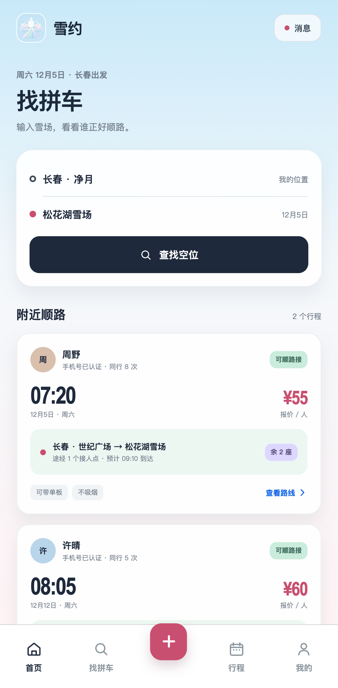
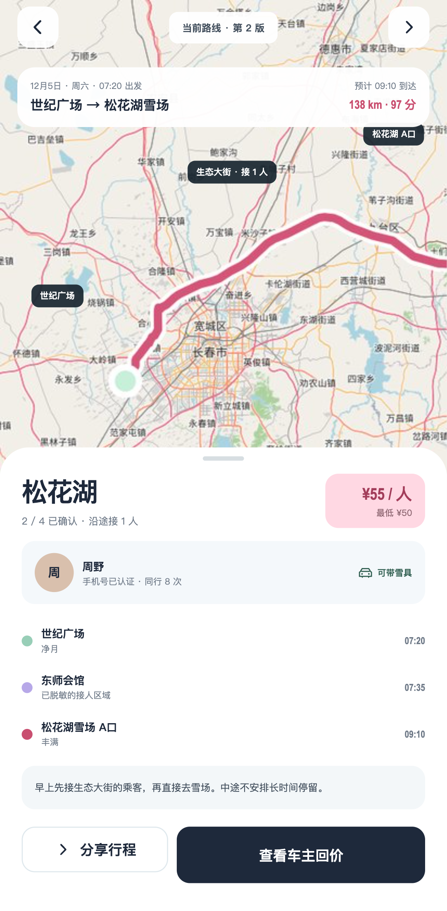
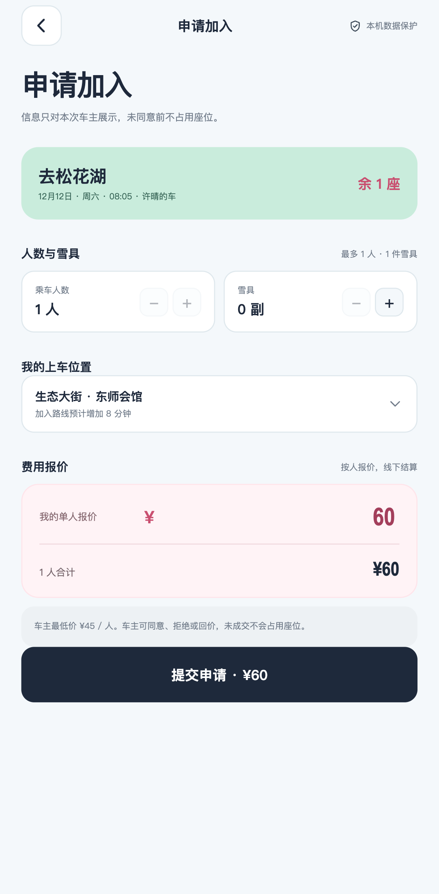
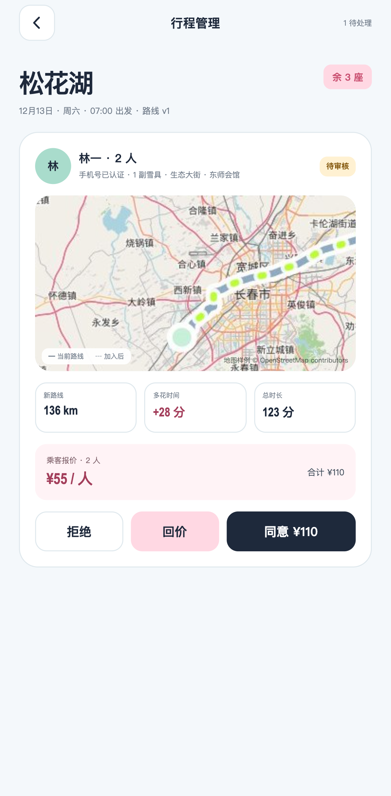

# 商店文案与审核材料

## 基本信息

| 字段 | 内容 |
| --- | --- |
| 应用名称 | 雪约 |
| 副标题建议 | 滑雪顺路拼车 |
| 包名 | `com.xueyue.snowdate`（已确认） |
| 分类 | 旅行与本地 / 生活方式 |
| 价格 | 免费，当前无内购和广告 |
| 语言 | 简体中文 |
| 隐私政策 | GitHub Pages 部署后填写 |
| 支持邮箱 | `wy_pule@163.com` |
| 开发者 | 蒲乐 |

## 简短描述

滑雪顺路拼车。看路线、查余位、按人报价，车主确认后一起出发。

## 完整描述

雪约帮助滑雪人群解决从市区到雪场的往返交通。车主可以发布出发地、时间、目标雪场、空余座位和最低价格；乘客可以按自己的上车位置报价申请。

主要功能：

- 找拼车：按雪场、日期和出发区域查找
- 路线详情：查看起终点、接人点、里程和预计时间
- 按人报价：选择同行人数和雪具数量，填写每人报价
- 车主审核：同时查看人数、路线变化和价格
- 一轮回价：乘客可以接受车主回价或放弃
- 路线联动：成交后座位、价格和路线版本同步更新
- 发布拼车：设置余座、雪具位、最低价和最大绕行

当前版本内容保存在设备本地。雪约不提供在线支付、资金托管或承运担保。双方确认的价格属于线下费用协商记录，实际出行前请确认车辆、路线、天气和雪场开放情况。

## 截图建议

1. 找拼车

2. 真实路线详情

3. 申请与报价

4. 车主审核

截图需要从最终构建重新生成，不能继续使用旧版“雪季行程”截图。

## 审核问卷

### 广告

无广告。

### 数据安全

- 如果生产构建未配置 `EXPO_PUBLIC_API_URL`，行程、报价、申请、昵称、手机号和车辆资料保存在设备本地，开发者服务器不接收这些数据。
- 如果启用雪约服务端 API，手机号、昵称、车辆资料、拼车、申请、通知和验证状态会传输到配置的服务端；提交前必须按实际部署重新填写 Data Safety。
- 用户主动分享时，邀请文案交给所选第三方应用。
- 当前未集成地图 SDK；正式接入高德后必须新增位置与第三方 SDK 声明。

### 内容分级

当前无公开用户内容、暴力、赌博或成人内容。

## 发布前替换

- 应用包名
- 隐私政策公开 URL
- 支持邮箱和开发者主体
- 高德地图 Key、签名 SHA1 与 SDK 隐私说明
- 最新商店截图
